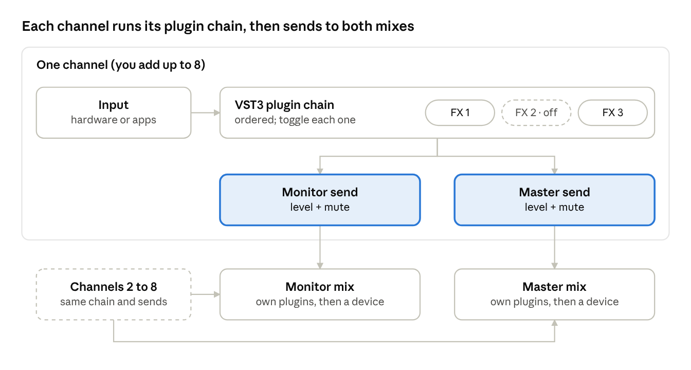

# Wave Link for Linux — What It Is

**Record — the product definition as handed over on 2026-11-02; intention, not yet built.** Its open questions (the name, the channel count, the plugin cap, app identity, PipeWire or JACK, the GUI stack, the buffer size, plugins in or out of process, devices per mix) were settled on 2026-11-03 in [the charter](../charter.md), which wins where the two differ.

Nov 2, 2026 · @Tempered

A native Linux desktop audio mixer, modeled on Elgato Wave Link, written in Rust. You add up to 8 input channels. Each channel runs its own chain of VST3 plugins that you can toggle on and off. Each channel then has two sends: one to the **Monitor** mix (your headphones) and one to the **Master** mix (your main output, which other apps can also record). Both mixes have their own plugin chains too.

It is a general desktop mixer, not a streaming tool. Wave Link has no Linux version, and Steinberg moving the VST3 SDK to the MIT license makes a permissively licensed Linux host practical.

## Target: Wave Link parity first

The first goal is to match classic Wave Link (the 2-mix version), not to beat it. Going past 8 channels is a maybe for later, not a v1 goal.

| Feature | Wave Link | Ours (v1) |
| --- | --- | --- |
| Input channels | Up to 9 virtual or physical inputs ([outputs guide](https://help.elgato.com/hc/en-us/articles/360045139191-Wave-Link-2-Outputs)); coverage of 2.0 calls it 8 extra sources ([AlternativeTo](https://alternativeto.net/news/2024/9/elgato-launches-wave-link-2-0-with-enhanced-audio-routing-app-grouping-and-sample-recorder/)) | 8 |
| Channel source | A hardware input, or a group of apps ticked from a list | Same |
| Output mixes | Monitor, Stream, plus MicrophoneFX for chat apps | Monitor, Master |
| Where a mix plays | Each mix plays to a device you pick; the Stream mix also shows up in other apps as a mic | Each mix plays to a device you pick; Master also shows up in other apps as an input they can record |
| Plugins per channel | Up to 10, processed top to bottom, drag to reorder ([effects guide](https://help.elgato.com/hc/en-us/articles/4416040077069)) | Ordered chain, drag to reorder, including between strips; cap to be decided |
| Plugins on the mixes | None in the 2-mix version, so a global EQ means one copy per channel | Each mix has its own chain |
| Plugin formats | VST2 and VST3 on Windows, AU on macOS | VST3 |
| Plugin toggles | Per plugin, plus switches for whether the chain reaches each mix ([1.4 notes](https://help.elgato.com/hc/en-us/articles/4914156978317-Elgato-Wave-Link-1-4-Release-Notes-Windows)) | Same: per plugin, plus MON and MST switches per chain |
| Opening a plugin | Through a settings icon | Double-click the plugin |
| Sends per channel | A fader and mute per mix, with a toggle that links the two faders | Same, with each fader drawn on a stereo meter |
| Hear the other mix | Ear icon switches your headphones to that mix | Preview button on Master plays it through the Monitor output |
| Level meters | Per channel and per mix | Stereo, per send and per mix, with peak hold |

Wave Link 3.0 has since moved to up to 5 custom mixes ([3.0 overview](https://www.elgato.com/lm/en/explorer/products/wave/wave-link-3-0-software-overview/)). That is a later target, not v1.

## Core concepts

The mixer has three building blocks: channels, plugins and sends.

- **Channel.** One audio source, up to 8 of them. It is one of two kinds: a hardware input (a mic, an interface input), or a group of apps you pick (Spotify, VLC and a DAW together as "Music"). You add, remove and name channels.
- **Plugin.** A VST3 effect in a chain. Every channel and both mixes have an ordered chain. Each plugin has an on/off toggle, and double-clicking it opens its own editor window.
- **Send.** Every channel has exactly two: a **Monitor send** and a **Master send**. Each has its own fader and mute, and a link toggle moves both faders together. Two switches on the channel's chain (MON, MST) choose which sends get the processed signal.
- **Mix.** The sum of all channels' sends of one kind, run through the mix's own plugin chain, then out to a device. **Monitor** is what you hear. **Master** is your main output, and other apps can also record it as an input.

## Assigning apps to channels

Clicking a channel's name opens one panel with its name, then a checklist of apps; ticked apps play into that channel. Wave Link added this recently, and it may be easier to build on Linux than on Windows.

- **What the user sees.** A name field, then a list of apps with checkboxes. Apps not running right now stay in the list, greyed out, so the assignment sticks between sessions.
- **How it works on Linux.** PipeWire tags every app's audio stream with properties like its app name and binary. When a stream appears, we match it against each channel's app list and link it to that channel's input. No driver or audio hook is needed.
- **What we save.** A channel stores app identifiers, not live stream ids, so an app is routed again each time it starts.
- **Unassigned apps.** They play to the system default output as usual.

## Signal flow

The channel's chain runs before the split. Its MON and MST switches decide whether each send gets the processed or the dry signal. Each mix then runs its own plugin chain before the output.

## UI direction

The working prototype is the [Mixer UI Prototype](https://claude.ai/artifact/Xt91Wx7DrX7JSRte8ZaHdu), now at version 5 (in `prototype/index.html`). Decisions so far:

- **One row of identical strips.** Input channels on the left, Monitor and Master on the right. Mix strips have the same layout as channels, plugin slots included.
- **Flat look.** Solid fills, 2px corners, no gradients or shadows. Color only for level, the fader line and active state.
- **Faders are stereo meters.** Each send is a pair of left and right bars with peak hold, and the fader is a line with a small triangle across them, like Ableton and Serum. Drag anywhere on it, Shift for fine moves, double-click for 0 dB.
- **Plugin slots on every strip.** Drag to reorder or onto another strip, Ctrl to copy. Hover for settings and remove. Double-click to open the plugin window.
- **Search-first plugin browser.** Typing filters at once, arrow keys and Enter add, with favorites, recent, type and maker as filters. No wall of vendor menus.
- **No helper text on the strips.** Labels and icons have to carry the meaning.

## v1 scope

Everything in the v1 list is something Wave Link already does.

**In v1**

- Add, remove and name up to 8 channels
- Make a channel a hardware input, or tick the apps that play into it
- Add, remove and reorder VST3 plugins on every channel and on both mixes
- Toggle each plugin on or off, and choose per channel whether its chain reaches Monitor, Master or both
- Monitor send and Master send per channel, each with a fader and mute, plus a fader link
- Level and mute on each mix
- Stereo level meters per send and per mix
- Pick the output device for each mix
- Expose Master as an input other apps can record
- Preview Master through the Monitor output
- Save and restore the whole setup, including plugin state and app assignments

**Not in v1**

- More than 8 channels, or more than 2 mixes
- A third chat mix like Wave Link's MicrophoneFX
- VST2, CLAP, LV2 or other plugin formats
- Stream Deck or MIDI controller support
- Windows or macOS builds

## Tech direction

Rust for everything, PipeWire for audio routing, VST3 for plugins. The GUI stack is still open.

- **Plugins: VST3.** Steinberg moved the VST3 SDK to the MIT license with version 3.8 in October 2025 ([Sonicstate](https://sonicstate.com/news/2025/10/30/vst-3-now-available-under-mit-license)). We can host VST3 without signing an agreement, as long as we keep the copyright and license text. VST2 is still under its old license, so it stays out.
- **Audio: PipeWire.** It is the default sound server on current major distros. Each app channel is an input node, and we link the apps assigned to it as they start. Master plays to a real device and is also published as a virtual source other apps can record.
- **Real-time rule.** The audio thread never allocates, locks or does I/O. The GUI talks to it through lock-free queues.
- **Plugin editors.** On Linux, a VST3 editor draws into a native X11 window the host provides. Whatever GUI we pick must be able to open such a window per plugin.

GUI candidates to evaluate:

| Option | What it is | Fit for this app |
| --- | --- | --- |
| egui / eframe | Immediate-mode, pure Rust | Fast to build meters and faders; less polished look out of the box |
| iced | Elm-style, pure Rust | Clean structure; custom widgets like faders take more work |
| Slint | Declarative UI language with a Rust API | Good for a designed, mixer-style look; check its license terms |
| GTK4 (gtk-rs) | Native GNOME toolkit | Most native on GNOME; heavier bindings |

## Open questions

- [ ] Is 8 the total, or 8 plus a dedicated mic channel? Wave Link's own count is 9.
- [ ] Do we cap plugins per strip? Wave Link stops at 10.
- [ ] How do we identify an app for routing: by its PipeWire app name, its binary, or both? Some apps (browsers, Electron, Flatpaks) report these inconsistently.
- [ ] PipeWire's native API, or the JACK API through PipeWire's JACK layer?
- [ ] Which GUI stack? The prototype's look needs custom-drawn meters and faders, so the stack must make those cheap.
- [ ] Latency target: what buffer size do we aim for by default?
- [ ] Do plugins run in our process, or in a separate one so a crashing plugin can't kill the mixer?
- [ ] Can a mix play to more than one device at once?
- [ ] What is the app called?

## Sources

- [Wave Link 2 Outputs](https://help.elgato.com/hc/en-us/articles/360045139191-Wave-Link-2-Outputs), Elgato Help Center
- [How to use VST Audio Effects in Wave Link](https://help.elgato.com/hc/en-us/articles/4416040077069), Elgato Help Center
- [Wave Link 1.4 Release Notes](https://help.elgato.com/hc/en-us/articles/4914156978317-Elgato-Wave-Link-1-4-Release-Notes-Windows), Elgato Help Center
- [Wave Link 3.0 Software Overview](https://www.elgato.com/lm/en/explorer/products/wave/wave-link-3-0-software-overview/), Elgato
- [Elgato launches Wave Link 2.0](https://alternativeto.net/news/2024/9/elgato-launches-wave-link-2-0-with-enhanced-audio-routing-app-grouping-and-sample-recorder/), AlternativeTo
- [VST 3 Now Available Under MIT License](https://sonicstate.com/news/2025/10/30/vst-3-now-available-under-mit-license), Sonicstate, 30 Oct 2025
